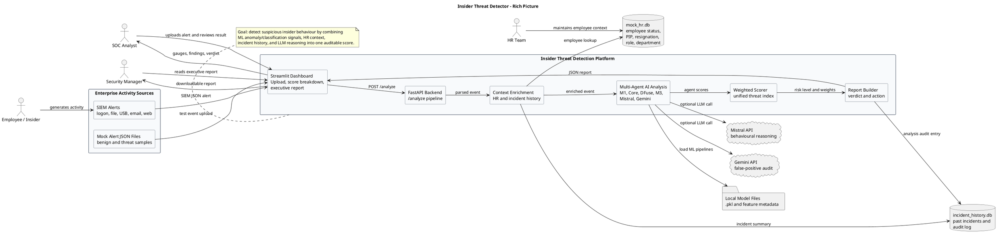
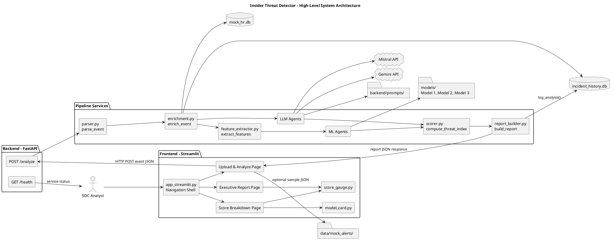
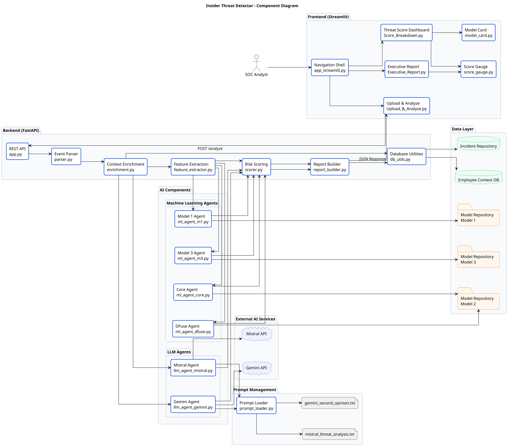
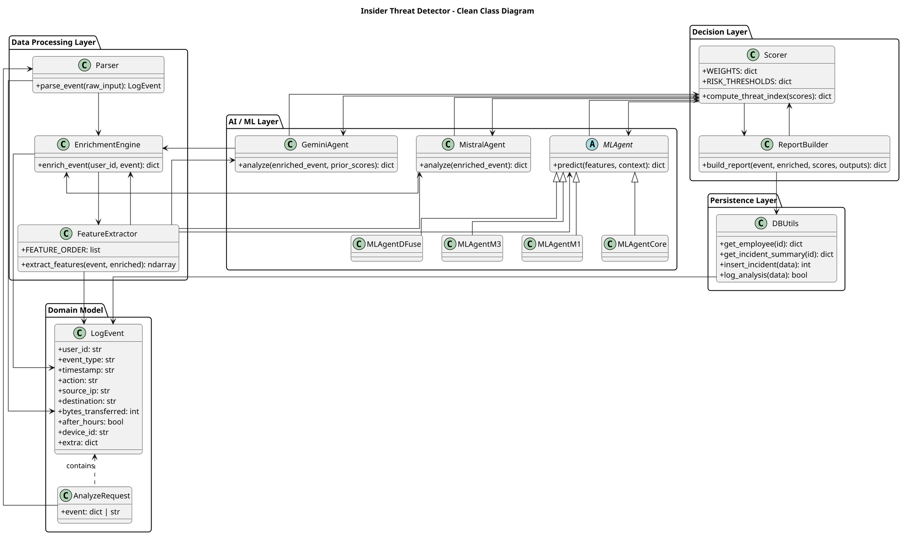
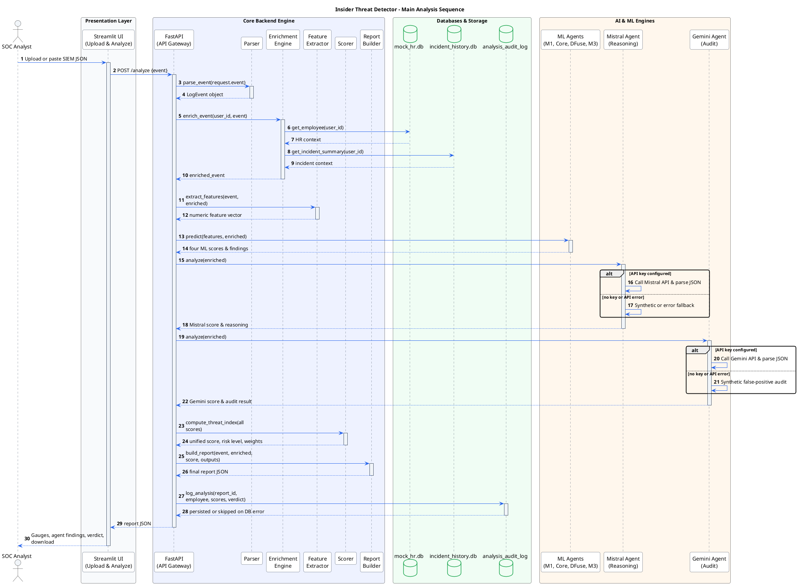
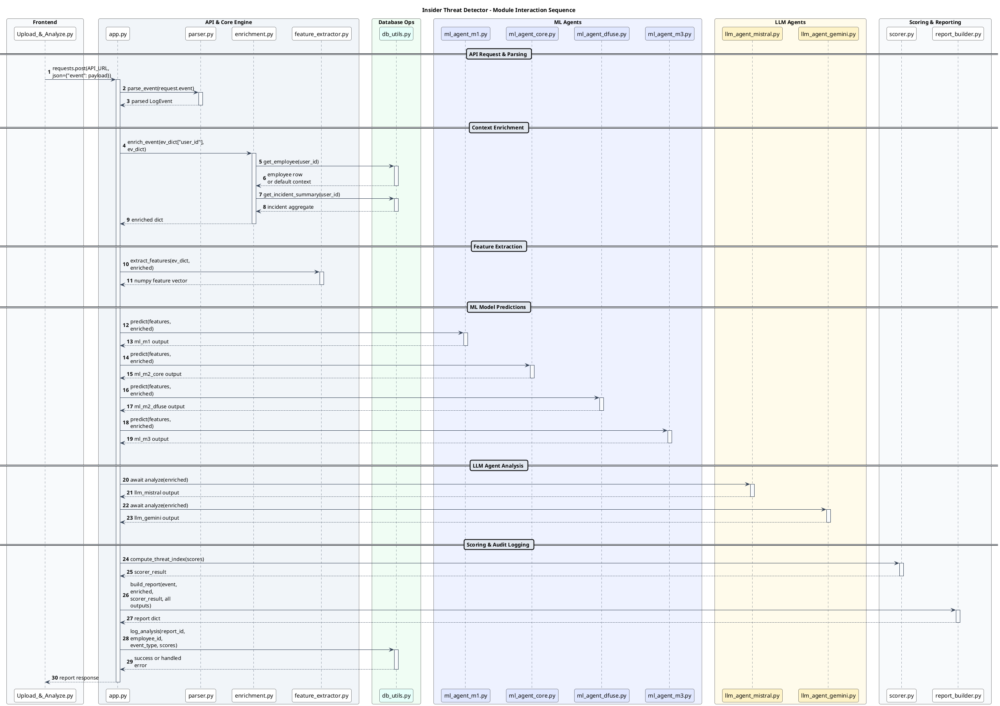
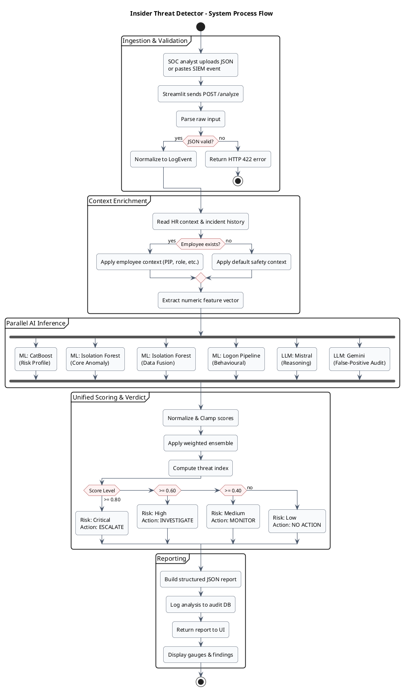
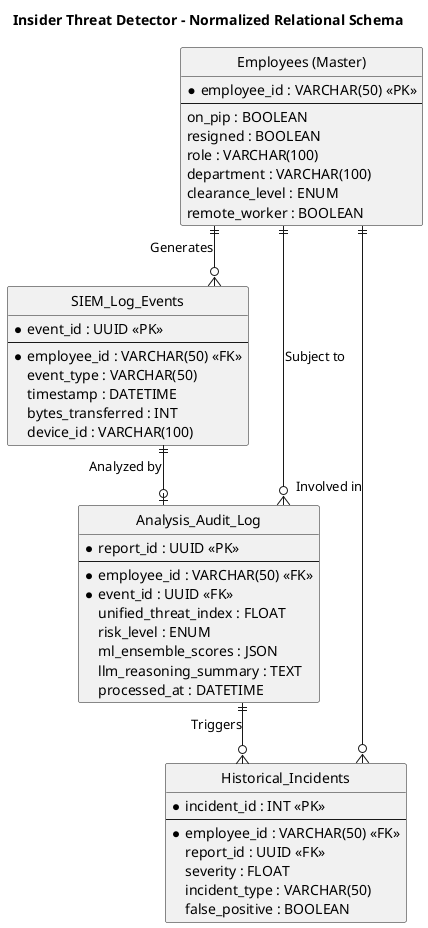

# Insider Threat Detector - PlantUML Designs

This page contains PlantUML source code for the main design diagrams of the Insider Threat Detector project.

## 1. Rich Picture Diagram

## 2. High-Level System Architecture

## 3. Component Diagram

## 4. Class Diagram

## 5. Sequence Diagram

## 6. Module Interaction Sequence Diagram

## 7. System Process Flow Chart

## 8. Database Design (ER Diagram)

