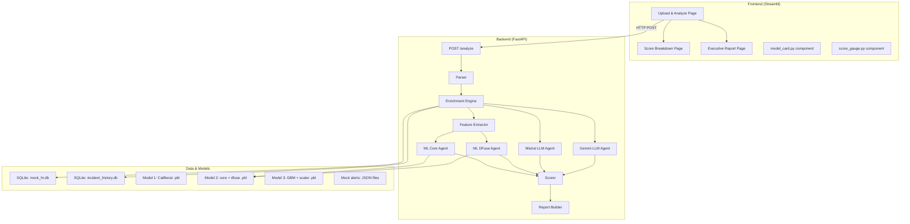

# 🛡️ Insider Threat Detection Tool — Full Walkthrough

## Overview

This is a **multi-agent AI-powered insider threat detection platform** that analyzes SIEM (Security Information and Event Management) log events to identify potential insider threats within an organization. It combines **machine learning anomaly detection** with **LLM-based reasoning** in an ensemble pipeline, producing a unified threat score and executive-level reports.

---

## Architecture at a Glance



---

## Full File Structure

```
Insider threat detector/
├── .env                          # (empty — needs API keys)
├── .gitignore                    # (empty)
├── READ.md                       # (empty)
├── requirements.txt              # (empty)
│
├── backend/
│   ├── app.py                    # FastAPI entrypoint — POST /analyze, GET /health
│   │
│   ├── agents/
│   │   ├── __init__.py           # (empty)
│   │   ├── ml_agent_core.py      # Anomaly detection with Gaussian Mixture Model
│   │   ├── ml_agent_dfuse.py     # Data fusion anomaly detection (similar to core)
│   │   ├── ml_agent_m1.py        # CatBoost classifier (21-feature CERT model)
│   │   ├── ml_agent_m3.py        # Gradient Boosting + StandardScaler (12-feature model)
│   │   ├── llm_agent_mistral.py  # ⚠️ EMPTY — needs implementation
│   │   └── llm_agent_gemini.py   # ⚠️ EMPTY — needs implementation
│   │
│   ├── db/
│   │   ├── __init__.py           # (empty)
│   │   ├── db_utils.py           # 471-line SQLite query layer (HR, incidents, audit log)
│   │   ├── mock_hr.db            # SQLite: employees table (PIP, resignation, role, dept)
│   │   ├── incident_history.db   # SQLite: incidents + analysis_audit_log tables
│   │   └── seed_mock_data.py     # ⚠️ EMPTY — needs seeding logic
│   │
│   ├── engine/
│   │   ├── __init__.py           # Exports: compute_threat_index, enrich_event, build_report
│   │   ├── scorer.py             # Weighted ensemble scoring (0-1 → low/medium/high/critical)
│   │   ├── enrichment.py         # Adds HR context + incident history to events
│   │   └── report_builder.py     # Assembles final JSON report with verdict
│   │
│   ├── prompts/
│   │   ├── __init__.py           # Exports prompt_loader public API
│   │   ├── prompt_loader.py      # Centralised prompt loading with caching + templating
│   │   ├── mistral_threat_analysis.txt  # ⚠️ EMPTY — needs prompt template
│   │   └── gemini_second_opinion.txt    # ⚠️ EMPTY — needs prompt template
│   │
│   └── utils/
│       ├── __init__.py           # Exports: parse_event, LogEvent, extract_features
│       ├── parser.py             # Validates & normalizes SIEM JSON events via Pydantic
│       └── feature_extractor.py  # Converts events → 13-dim numeric feature vectors
│
├── frontend/
│   ├── app_streamlit.py          # Streamlit main page (welcome + navigation)
│   ├── components/
│   │   ├── model_card.py         # Reusable model metadata card with Plotly charts
│   │   └── score_gauge.py        # Threat score gauge widget (full + mini modes)
│   └── pages/
│       ├── Upload_&_Analyze.py   # File upload or paste JSON → calls POST /analyze
│       ├── Score_Breakdown.py    # Per-agent scores, Plotly gauge, agent findings
│       └── Executive_Report.py   # Full threat report with verdict + download
│
├── data/
│   ├── mock_alerts/
│   │   ├── benign/               # 3 sample benign alert JSONs
│   │   └── threats/              # 3 sample threat alert JSONs
│   └── raw/                      # (empty — for raw training data)
│
├── models/
│   ├── model 1/                  # CatBoost: catboost_cert_insider_threat_model.pkl + feature names
│   ├── model 2/                  # Core + DFuse: model2_core_model.pkl, model2_dfuse_model.pkl
│   └── model 3/                  # GBM logon: model3_gb_logon.pkl + scaler + metadata
│
├── docs/                         # (empty)
└── tests/                        # (empty)
```

---

## The 7-Stage Detection Pipeline

The core logic lives in [app.py](file:///c:/Users/thisa/Desktop/Learn/Learn%204/Insider%20threat%20detection/Insider%20threat%20detector/backend/app.py#L53-L96) and executes this pipeline on every `POST /analyze` request:

| Stage | Module | What It Does |
|-------|--------|-------------|
| **1. Parse & Validate** | [parser.py](file:///c:/Users/thisa/Desktop/Learn/Learn%204/Insider%20threat%20detection/Insider%20threat%20detector/backend/utils/parser.py) | Validates JSON/dict input against a Pydantic `LogEvent` schema (requires `user_id`, `event_type`, `timestamp`, `action`) |
| **2. Enrich** | [enrichment.py](file:///c:/Users/thisa/Desktop/Learn/Learn%204/Insider%20threat%20detection/Insider%20threat%20detector/backend/engine/enrichment.py) | Looks up HR context (PIP status, resignation, role) + incident history from SQLite |
| **3. Feature Extraction** | [feature_extractor.py](file:///c:/Users/thisa/Desktop/Learn/Learn%204/Insider%20threat%20detection/Insider%20threat%20detector/backend/utils/feature_extractor.py) | Converts event + enrichment into a 13-dimensional numeric vector |
| **4. ML Agents** | [ml_agent_core.py](file:///c:/Users/thisa/Desktop/Learn/Learn%204/Insider%20threat%20detection/Insider%20threat%20detector/backend/agents/ml_agent_core.py), [ml_agent_dfuse.py](file:///c:/Users/thisa/Desktop/Learn/Learn%204/Insider%20threat%20detection/Insider%20threat%20detector/backend/agents/ml_agent_dfuse.py) | Two anomaly scoring models producing 0.0–1.0 scores |
| **5. LLM Agents** | `llm_agent_mistral.py`, `llm_agent_gemini.py` | ⚠️ **Not yet implemented** — Mistral for threat reasoning, Gemini for cross-examination |
| **6. Score** | [scorer.py](file:///c:/Users/thisa/Desktop/Learn/Learn%204/Insider%20threat%20detection/Insider%20threat%20detector/backend/engine/scorer.py) | Weighted average: Core (35%) + DFuse (25%) + Mistral (25%) + Gemini (15%) → risk level |
| **7. Report** | [report_builder.py](file:///c:/Users/thisa/Desktop/Learn/Learn%204/Insider%20threat%20detection/Insider%20threat%20detector/backend/engine/report_builder.py) | Produces structured JSON with threat assessment, agent findings, verdict, and action |

---

## The 4 Agents

### ML Agents (Implemented)

| Agent | File | Model Type | Approach |
|-------|------|-----------|----------|
| **ML Core** | [ml_agent_core.py](file:///c:/Users/thisa/Desktop/Learn/Learn%204/Insider%20threat%20detection/Insider%20threat%20detector/backend/agents/ml_agent_core.py) | Gaussian Mixture / Isolation Forest | Anomaly scoring via `score_samples()`, min-max normalized |
| **ML DFuse** | [ml_agent_dfuse.py](file:///c:/Users/thisa/Desktop/Learn/Learn%204/Insider%20threat%20detection/Insider%20threat%20detector/backend/agents/ml_agent_dfuse.py) | Same architecture as Core | Data-fusion variant with different feature set |
| **ML M1** *(extra)* | [ml_agent_m1.py](file:///c:/Users/thisa/Desktop/Learn/Learn%204/Insider%20threat%20detection/Insider%20threat%20detector/backend/agents/ml_agent_m1.py) | CatBoost Classifier | 21-feature CERT dataset model, returns `predict_proba` |
| **ML M3** *(extra)* | [ml_agent_m3.py](file:///c:/Users/thisa/Desktop/Learn/Learn%204/Insider%20threat%20detection/Insider%20threat%20detector/backend/agents/ml_agent_m3.py) | Gradient Boosting + Scaler | 12-feature logon pattern model |

> [!NOTE]
> `ml_agent_m1.py` and `ml_agent_m3.py` exist but are **not wired** into the main pipeline in `app.py`. Only `ml_agent_core` and `ml_agent_dfuse` are used in the ensemble.

### LLM Agents (Stubs — Not Implemented)

| Agent | File | Intended Role |
|-------|------|--------------|
| **Mistral** | `llm_agent_mistral.py` | Primary behavioural anomaly reasoning via Mistral API |
| **Gemini** | `llm_agent_gemini.py` | Cross-examination / false-positive audit via Gemini API |

Both files are **empty**. The prompt templates for them also exist but are empty:
- [mistral_threat_analysis.txt](file:///c:/Users/thisa/Desktop/Learn/Learn%204/Insider%20threat%20detection/Insider%20threat%20detector/backend/prompts/mistral_threat_analysis.txt)
- [gemini_second_opinion.txt](file:///c:/Users/thisa/Desktop/Learn/Learn%204/Insider%20threat%20detection/Insider%20threat%20detector/backend/prompts/gemini_second_opinion.txt)

---

## Scoring System

The [scorer.py](file:///c:/Users/thisa/Desktop/Learn/Learn%204/Insider%20threat%20detection/Insider%20threat%20detector/backend/engine/scorer.py) applies a **weighted ensemble**:

| Agent | Weight |
|-------|--------|
| ML Core | **35%** |
| ML DFuse | **25%** |
| LLM Mistral | **25%** |
| LLM Gemini | **15%** |

The unified threat index (0.0–1.0) maps to risk levels:

| Score | Risk Level | Verdict Action |
|-------|-----------|----------------|
| ≥ 0.80 | 🔴 CRITICAL | ESCALATE IMMEDIATELY |
| ≥ 0.60 | 🟠 HIGH | INVESTIGATE |
| ≥ 0.40 | 🟡 MEDIUM | MONITOR |
| < 0.40 | 🟢 LOW | NO ACTION |

---

## Database Layer

The [db_utils.py](file:///c:/Users/thisa/Desktop/Learn/Learn%204/Insider%20threat%20detection/Insider%20threat%20detector/backend/db/db_utils.py) is the most complete module (471 lines) and provides:

- **HR queries**: `get_employee()`, `get_employees_by_department()`, `get_high_risk_hr_employees()`, `upsert_employee()`
- **Incident queries**: `get_incident_summary()`, `get_recent_incidents()`, `insert_incident()`, `mark_false_positive()`
- **Audit log**: `log_analysis()`, `get_audit_log()`, `get_risk_trend()`
- **Health checks**: `health_check_dbs()`

Uses two SQLite databases:
- `mock_hr.db` — employees table (PIP status, resignation, role, department, clearance level)
- `incident_history.db` — incidents + analysis_audit_log tables

---

## Frontend (Streamlit)

3 pages + 2 reusable components:

| Page | Purpose |
|------|---------|
| [Upload & Analyze](file:///c:/Users/thisa/Desktop/Learn/Learn%204/Insider%20threat%20detection/Insider%20threat%20detector/frontend/pages/Upload_%26_Analyze.py) | File upload or paste JSON → sends to `POST /analyze` → stores report in session state |
| [Score Breakdown](file:///c:/Users/thisa/Desktop/Learn/Learn%204/Insider%20threat%20detection/Insider%20threat%20detector/frontend/pages/Score_Breakdown.py) | Plotly gauge for unified score, per-agent bars, agent reasoning JSON |
| [Executive Report](file:///c:/Users/thisa/Desktop/Learn/Learn%204/Insider%20threat%20detection/Insider%20threat%20detector/frontend/pages/Executive_Report.py) | Formal report with verdict, HR context, score table, JSON download |

Components:
- [model_card.py](file:///c:/Users/thisa/Desktop/Learn/Learn%204/Insider%20threat%20detection/Insider%20threat%20detector/frontend/components/model_card.py) — Rich model cards with training stats, validation metrics, feature importance bar charts
- [score_gauge.py](file:///c:/Users/thisa/Desktop/Learn/Learn%204/Insider%20threat%20detection/Insider%20threat%20detector/frontend/components/score_gauge.py) — Full-size + mini Plotly gauge widgets with risk-aware coloring

---

## Mock Test Data

6 sample SIEM alerts under [data/mock_alerts/](file:///c:/Users/thisa/Desktop/Learn/Learn%204/Insider%20threat%20detection/Insider%20threat%20detector/data/mock_alerts):

**Benign:**
- `benign_001_large_download_product_launch.json`
- `benign_002_oncall_afterhours_login.json`
- `benign_003_backup_job_file_transfer.json`

**Threats:**
- `threat_001_usb_exfil_after_resignation.json`
- `threat_002_afterhours_source_code_download.json`
- `threat_003_credential_sharing.json`

---

## What's Incomplete / Needs Work

> [!IMPORTANT]
> The following areas are **empty stubs** that need implementation:

| Area | File | Status |
|------|------|--------|
| Mistral LLM Agent | `llm_agent_mistral.py` | ❌ Empty |
| Gemini LLM Agent | `llm_agent_gemini.py` | ❌ Empty |
| Mistral Prompt | `mistral_threat_analysis.txt` | ❌ Empty |
| Gemini Prompt | `gemini_second_opinion.txt` | ❌ Empty |
| DB Seed Script | `seed_mock_data.py` | ❌ Empty |
| README | `READ.md` | ❌ Empty |
| Requirements | `requirements.txt` | ❌ Empty |
| Environment Config | `.env` | ❌ Empty (needs API keys) |
| `.gitignore` | `.gitignore` | ❌ Empty |
| Tests | `tests/` | ❌ Empty directory |
| Docs | `docs/` | ❌ Empty directory |

> [!WARNING]
> **Critical mismatch in `app.py`**: The main pipeline imports `MLAgentCore` and `MLAgentDFuse` as classes with `.predict()` methods, but the actual agent files ([ml_agent_core.py](file:///c:/Users/thisa/Desktop/Learn/Learn%204/Insider%20threat%20detection/Insider%20threat%20detector/backend/agents/ml_agent_core.py), [ml_agent_dfuse.py](file:///c:/Users/thisa/Desktop/Learn/Learn%204/Insider%20threat%20detection/Insider%20threat%20detector/backend/agents/ml_agent_dfuse.py)) only expose **standalone functions** (`run_core()`, `run_dfuse()`), not classes. Similarly, `MistralAgent` and `GeminiAgent` are imported as classes but their files are empty. The app will crash at startup.

> [!WARNING]
> **Model path mismatches**: The agents reference `models/core_model.pkl` and `models/dfuse_model.pkl`, but the actual files are inside subdirectories: `models/model 2/model2_core_model.pkl` and `models/model 2/model2_dfuse_model.pkl`. These paths need alignment.
